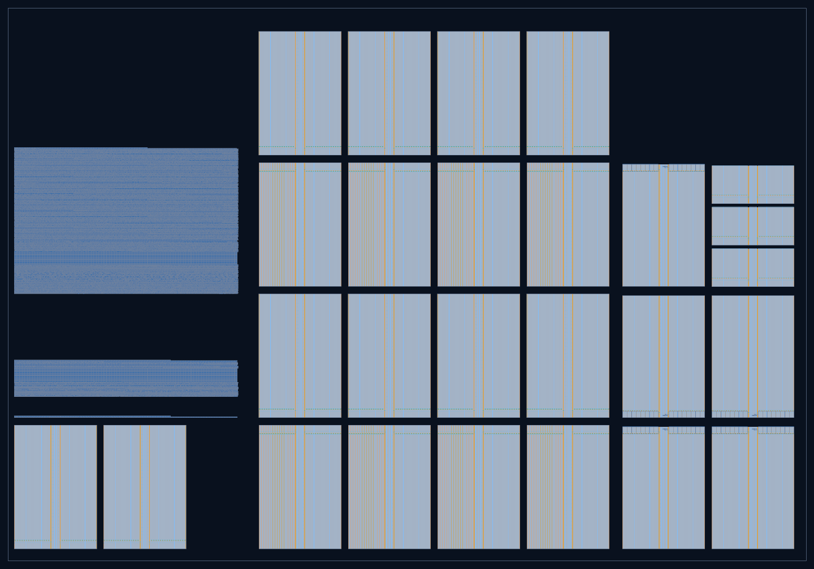

# CapsuleAI SoC · GDSII dan SRAM

Preview fisik CapsuleAI pada IHP SG13G2, dengan 78.477 standard cell hasil sintesis PicoRV32 dan CNN accelerator serta 26 makro SRAM dari IHP Open PDK. Gambar di bawah dirender langsung dari GDSII dengan KLayout.

[Buka penjelajah layout di GitHub Pages](https://wlmoi.github.io/capsuleai-soc-gds/)



[Unduh GDSII](layout/capsoc_floorplan.gds) · [Koordinat dan orientasi](layout/placement.json) · [Palet layer KLayout](layout/sg13g2-preview.lyp)

Layout ini berada pada tahap **placement preview**. Logika berasal dari sintesis RTL, dan makro SRAM berisi geometri PDK. Standard cell disusun pada row tanpa optimasi konektivitas. SRAM belum terhubung ke empat antarmuka memori RTL. Routing, jaringan daya, clock tree, timing closure, DRC, dan LVS masih terbuka.

## Penempatan SRAM

Template [IHP PRISM](https://github.com/kdp1965/ihp-um-janestreet-prism) menumpuk dua SRAM di kiri. Di CapsuleAI, bank aktivasi berada di kanan logika CNN, bank bobot dan requant berada di ujung kanan, dan SRAM firmware berada di bawah PicoRV32. Ukuran die untuk studi penempatan ini adalah **4.040 × 2.800 µm**. Konfigurasi menyimpan koordinat dan orientasi makro secara terpisah dari RTL.

| Kelompok | Makro IHP | Posisi | Alokasi |
| --- | --- | --- | --- |
| Firmware | 2 × 2048 × 32 bit | Kiri bawah | 16 KiB untuk firmware dan stack |
| Aktivasi | 16 × 2048 × 32 bit | Tengah kanan | 8 bank per buffer ping-pong, 16 bit data per word |
| Bobot | 5 × 4096 × 16 bit | Kanan | 20.480 word untuk 18.608 word bobot |
| Requant | 3 × 512 × 32 bit | Kanan, di atas bank bobot bawah | 3 bagian × 32 bit untuk setiap record 96 bit |

Jumlah makro mengikuti kapasitas per kelompok. Port paralel memerlukan pemetaan alamat, penanganan konflik antarpembacaan, dan penyesuaian latensi baca SRAM sinkron. Bobot, konstanta requant, firmware, dan frame juga membutuhkan jalur inisialisasi saat chip dinyalakan.

## Buka dan bangun ulang

Buka `layout/capsoc_floorplan.gds` di KLayout dan pilih top cell `capsoc_floorplan`. Muat `layout/sg13g2-preview.lyp` untuk melihat palet pada preview. Workflow GitHub mengikuti pola template PRISM dengan pemeriksaan GDS dan pengemasan hasil sebagai artifact.

Dari root repo, jalankan perintah berikut dengan Python 3.11 dan Yosys 0.51 yang menyertakan ABC. Untuk memindahkan SRAM, ubah `origin_um`, `pitch_um`, atau `row_orientations` di `layout/floorplan.json` dan jalankan ulang dua perintah terakhir.

```sh
python -m pip install -r requirements.txt
python tools/fetch_pdk.py
yosys -l build/synth.log tools/synth.ys
python tools/floorplan.py
python tools/render.py
```

`python tools/floorplan.py --verify` membaca ulang GDSII dan memeriksa hierarki, jumlah standard cell, serta posisi, orientasi, dan batas makro. Verifikasi ini menguji geometri penempatan. `reference/` menyimpan laporan sintesis dari arsip RTL awal untuk pembanding.

Sumber desain berasal dari arsip CapsuleAI. Aset fisik IHP memakai [IHP Open PDK](https://github.com/IHP-GmbH/IHP-Open-PDK/tree/e73adb4045731ddec21634146d536380057f6a26), dengan lisensi di `reference/LICENSE-IHP-Open-PDK`. Pemberitahuan lisensi PicoRV32 tersedia di file sumbernya. Frame medis dan berkas bobot model tidak termasuk dalam repo. Untuk menjalankan testbench asli, gunakan file `frame*.mem`, `weights.mem`, dan `requant.mem` dari arsip awal sesuai nama yang dirujuk di `tb/tb_soc.v`.
